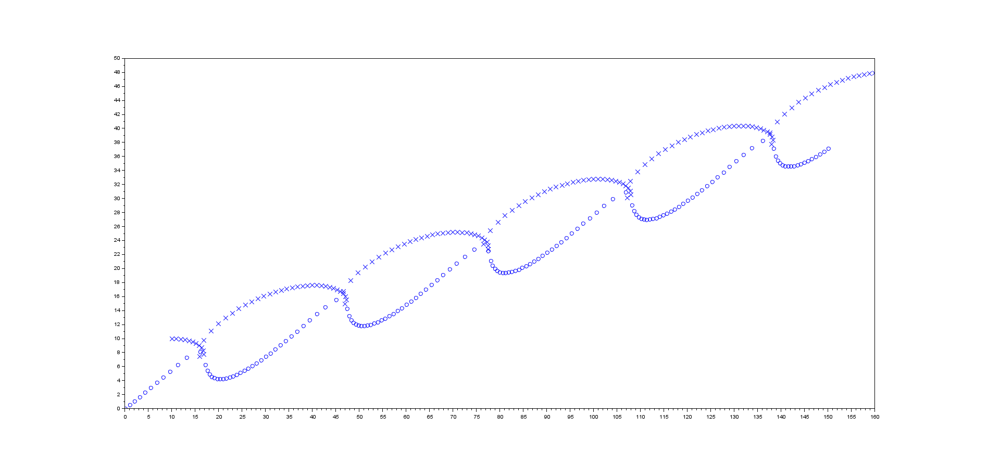

# Two-body orbit simulation

**Orbits from Newtonian gravitation, in Scilab and Python**

[](LICENSE)
[](https://www.python.org/)
[](https://www.scilab.org/)

This project solves the two-body problem for a range of initial conditions. The
original Scilab code integrates the equations of motion with `ode`; the Python
version uses `solve_ivp` and adds an interactive interface for changing the
masses, the gravitational constant, and the initial velocities.

**Author:** Zain Ul Abideen
**GitHub repository:** [dominuszain/TwoBodyOrbitSimulation](https://github.com/dominuszain/TwoBodyOrbitSimulation)



[Watch the longer simulation](docs/exotic-orbits.mp4) (MP4, 13 MB).

## Python simulation

```bash
cd python
pip install numpy scipy matplotlib
python gravitation_sim.py
```

The window has sliders for `G`, `M1`, `M2`, `v_x2`, and `v_y2`, plus presets for
a star–planet system, a binary star, and a slingshot. See
[`python/README.md`](python/README.md) for details.

## Original Scilab code

Open `main.sce` in Scilab and run it. The script converts the second-order
equation of motion into eight first-order equations and integrates them with
Scilab's `ode`. The course report is [`main.pdf`](main.pdf).

## Method

For two masses separated by **r**, the acceleration of each body is

```
a₁ = G m₂ (r₂ - r₁) / |r₂ - r₁|³
a₂ = G m₁ (r₁ - r₂) / |r₂ - r₁|³
```

The state vector is `[x₁, y₁, x₂, y₂, vx₁, vy₁, vx₂, vy₂]`. Both implementations
integrate this system; the Python version uses an adaptive Runge–Kutta method.

## Repository layout

```
.
├── python/           # interactive Python simulation
├── docs/             # figures and rendered video
├── main.sce          # original Scilab code
├── main.pdf          # course report
├── CITATION.cff
└── LICENSE
```

## Citation

```bibtex
@software{ulabideen_twobody_2026,
  author = {Ul Abideen, Zain},
  title  = {Two-body orbit simulation},
  year   = {2026},
  url    = {https://github.com/dominuszain/TwoBodyOrbitSimulation}
}
```

## License

Released under the [MIT License](LICENSE).
